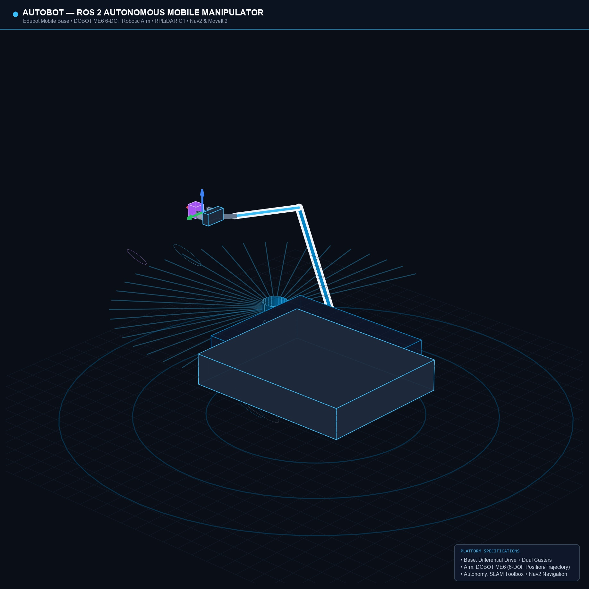
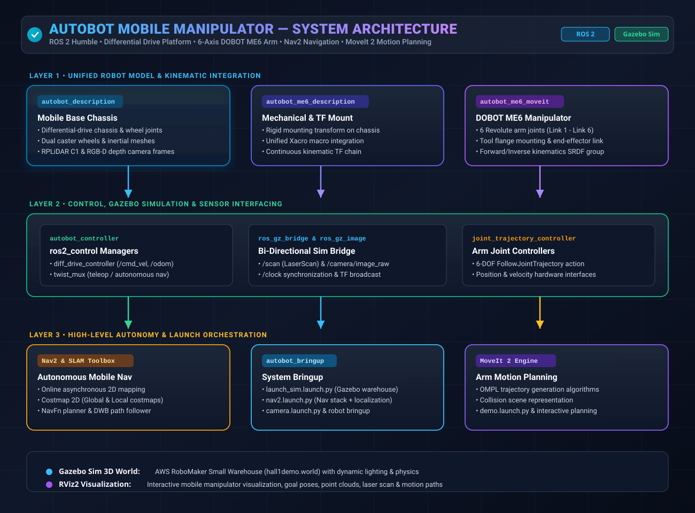

# 🤖 Autobot — ROS 2 Autonomous Mobile Manipulator

[](https://docs.ros.org/en/humble/)
[](https://releases.ubuntu.com/22.04/)
[](LICENSE)
[](https://gazebosim.org/)
[](https://moveit.ros.org/)

A ROS 2 Humble workspace integrating a **differential-drive mobile base** with a **DOBOT ME6 six-axis manipulator** — simulation, motion planning, and autonomous navigation in one unified platform.



---

## ✨ Features

| Capability | Description |
|---|---|
| 🔧 **Combined Robot Model** | Mobile chassis + differential-drive wheels + casters + ME6 6-DOF arm in one unified URDF/Xacro |
| 🎮 **Gazebo Simulation** | Full simulation with `ros2_control`, drive/arm controllers, warehouse world |
| 🦾 **Arm Motion Planning** | MoveIt 2 configuration with OMPL planning, joint limits, kinematics |
| 🗺️ **SLAM & Navigation** | SLAM Toolbox mapping + Nav2 autonomous navigation with saved maps |
| 📷 **Sensors** | Camera and LiDAR frames with Gazebo sensor plugins |

## 🏗️ System Architecture



## 📦 Packages

```
src/
├── autobot_bringup/          # Launch orchestration (sim, SLAM, Nav2, camera)
├── autobot_controller/       # Controller configs, Nav2/SLAM params, saved maps
├── autobot_description/      # Mobile base URDF, meshes, Gazebo worlds
├── autobot_me6_description/  # Combined base + ME6 arm model
└── autobot_me6_moveit/       # MoveIt 2 arm planning configuration
```

## 🚀 Quick Start

### Prerequisites

- Ubuntu 22.04
- ROS 2 Humble
- Gazebo Sim, ros2_control, MoveIt 2, Nav2, SLAM Toolbox

### Build

```bash
# Clone the repo
git clone https://github.com/ramcharan377/autobot_mobile_manipulator_ros2.git
cd autobot_mobile_manipulator_ros2/autobot_mobile_manipulator

# Source ROS 2
source /opt/ros/humble/setup.bash

# Import DOBOT ME6 vendor packages
sudo apt install -y python3-vcstool
vcs import src < dobot-dependencies.repos

# Install dependencies & build
rosdep install --from-paths src --ignore-src -r -y
colcon build --symlink-install
source install/setup.bash
```

### Launch

```bash
# 1. View robot model in RViz
ros2 launch autobot_me6_description display.launch.py

# 2. Gazebo simulation (warehouse world)
ros2 launch autobot_bringup launch_sim.launch.py

# 3. MoveIt 2 arm planning demo
ros2 launch autobot_me6_moveit demo.launch.py

# 4. Full navigation stack (sim + SLAM + Nav2)
ros2 launch autobot_bringup nav2.launch.py
```

## ⚠️ Notes

- The MoveIt config uses `mock_components/GenericSystem` — virtual planning only, not for physical arm control.
- Physical deployment requires a validated DOBOT ME6 hardware driver and safety checks.
- The warehouse world uses [AWS RoboMaker](https://github.com/aws-robotics/aws-robomaker-small-warehouse-world) assets (MIT-0 license).

## 📄 Documentation

- [Architecture Overview](autobot_mobile_manipulator/docs/ARCHITECTURE.md)
- [Package Inventory](autobot_mobile_manipulator/docs/PACKAGE_INVENTORY.md)
- [Validation Notes](autobot_mobile_manipulator/docs/VALIDATION_NOTES.md)
- [Third-Party Notices](autobot_mobile_manipulator/THIRD_PARTY_NOTICES.md)

## 📝 License

This project is licensed under the [MIT License](LICENSE).

## 👤 Author

**Athyam Ramcharan**  
GitHub: [@ramcharan377](https://github.com/ramcharan377)

---

⭐ If you find this project useful, give it a star!

