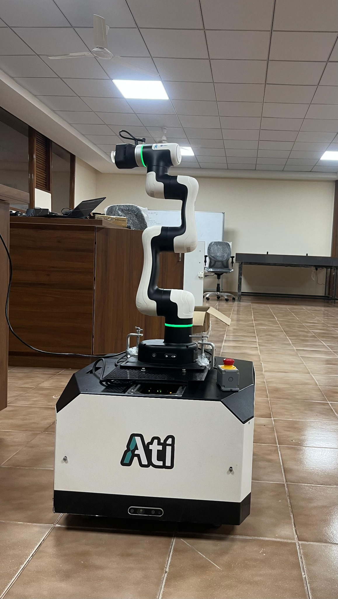
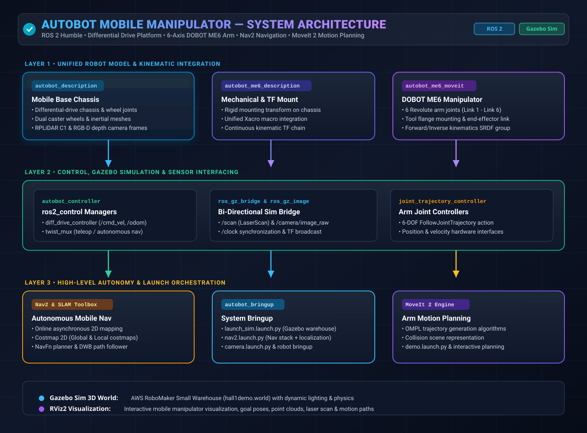

# ROS 2 Autonomous Mobile Manipulator — Sherpa / Edubot + DOBOT ME6

A ROS 2 Humble workspace integrating an Edubot/Sherpa-style differential-drive mobile base with a DOBOT ME6 six-axis manipulator. The repository preserves the project packages for robot description, simulation bringup, controller/navigation configuration, and MoveIt 2 setup.

**Project integration / repository maintainer:** Athyam Ramcharan  
**ROS distribution:** ROS 2 Humble  
**Target OS in the source environment:** Ubuntu 22.04  
**Arm:** DOBOT ME6  
**Simulation:** Gazebo Sim (`ros_gz`) and `ros2_control`  
**Motion planning:** MoveIt 2  
**Mobile navigation configuration:** SLAM Toolbox and Nav2

> Generated `build/`, `install/`, and `log/` folders, stale backups, duplicate standalone ME6 configurations, saved SLAM `.data` / `.posegraph` files, and unrelated Gazebo model assets have been excluded. The project source packages are retained under `src/`.

## Project overview

The core integration joins the mobile base and the ME6 manipulator into one Xacro robot description. The arm is attached to the mobile chassis through a fixed mounting link/joint. The workspace includes the base geometry and sensor frames, ME6 arm kinematic description, MoveIt planning configuration, Gazebo simulation control interfaces, and Nav2/SLAM configuration for the mobile platform.

### Mobile manipulator hardware



*Mobile base with a mounted robotic arm.*




## Main capabilities represented in this workspace

- **Combined robot model:** mobile chassis, differential-drive wheels, caster links, sensor frames, ME6 mounting plate and six arm joints.
- **Robot description:** Xacro/URDF assets and RViz configurations for inspecting the base and combined mobile manipulator.
- **Gazebo simulation:** a combined robot model with a Gazebo `ros2_control` plugin, drive/arm controllers, ROS-Gazebo bridge configuration and a warehouse world.
- **Arm motion planning:** a dedicated ME6 MoveIt 2 configuration with joint limits, kinematics, planning scene, controller mapping and launch files.
- **Mobile navigation configuration:** Nav2, SLAM Toolbox, map server/localization launch files, controller parameters and a saved occupancy-grid map.
- **Camera and laser model:** Xacro sensor frames and Gazebo sensor definitions included in the mobile-base description.

The supplied combined MoveIt configuration uses `mock_components/GenericSystem` for the arm. This is a fake/simulation control system, not a physical ME6 hardware driver. The combined Gazebo model uses the Ignition/Gazebo `ros2_control` system plugin.

## Repository structure

```text
ros2-autonomous-mobile-manipulator/
├── README.md
├── THIRD_PARTY_NOTICES.md
├── LICENSE_STATUS.md
├── dobot-dependencies.repos
├── .gitignore
├── assets/
│   ├── mobile-manipulator-hardware.jpeg
│   └── system-architecture.svg
├── docs/
│   ├── ARCHITECTURE.md
│   ├── PACKAGE_INVENTORY.md
│   └── VALIDATION_NOTES.md
├── licenses/
│   └── AWS-RoboMaker-MIT-0.txt
└── src/
    ├── autobot_bringup/
    ├── autobot_controller/
    ├── autobot_description/
    ├── autobot_me6_description/
    └── autobot_me6_moveit/
```

## External DOBOT ROS 2 dependency

DOBOT's own packages (`cra_description`, `dobot_rviz`, and related ME6 support packages) are not copied into this repository. They are imported from the official DOBOT repository at a pinned commit using `dobot-dependencies.repos`. This keeps vendor files, authorship and license notices with the upstream project.

```bash
sudo apt update
sudo apt install -y python3-vcstool
vcs import src < dobot-dependencies.repos
```

Upstream: [Dobot-Arm/DOBOT_6Axis_ROS2_V4](https://github.com/Dobot-Arm/DOBOT_6Axis_ROS2_V4)  
Pinned commit: `0f21e9839888f188ac06b0a9fea622d13a29a74f`

## Build environment

The project targets Ubuntu 22.04 and ROS 2 Humble. Install the ROS packages needed by the selected workflows (Gazebo Sim / `ros_gz`, `ros2_control`, MoveIt 2, Nav2, SLAM Toolbox, RViz and controller plugins) before building.

```bash
source /opt/ros/humble/setup.bash
cd ~/ros2-autonomous-mobile-manipulator

# Import the DOBOT packages required by the ME6 description/configuration.
vcs import src < dobot-dependencies.repos

# Resolve declared package dependencies, then build.
rosdep install --from-paths src --ignore-src -r -y
colcon build --symlink-install
source install/setup.bash
```

## Launch workflows

### 1. View the combined robot description

```bash
ros2 launch autobot_me6_description display.launch.py
```

This launches the combined Xacro description with `robot_state_publisher`, a joint-state GUI and RViz.

### 2. Start the combined Gazebo simulation

```bash
ros2 launch autobot_bringup launch_sim.launch.py
```

The launch file defaults to `hall1demo.world`. It spawns the combined robot and starts the configured wheel and ME6 controllers, `ros_gz_bridge`, and the Gazebo camera image bridge.

### 3. Start the combined ME6 MoveIt configuration

```bash
ros2 launch autobot_me6_moveit demo.launch.py
```

The checked-in MoveIt control Xacro uses `mock_components/GenericSystem`. Use it for virtual planning/visualization only; it does not command the physical DOBOT arm.

### 4. Start the mobile navigation workflow

```bash
ros2 launch autobot_bringup nav2.launch.py
```

This launch composes the simulation, localization and navigation workflows using the saved `small_warehouse_savee` map. Confirm the map/world alignment and all Nav2 parameters on the target setup before relying on navigation results.

## Scope and limitations

- This repository contains the combined mobile-base + ME6 model, simulation/control configuration, MoveIt configuration and mobile navigation/SLAM configurations.
- It does not contain a project-specific object-detection, autonomous grasp-selection or task-level pick-and-place application.
- The ME6 MoveIt configuration uses a mock hardware interface. Physical ME6 execution requires an appropriately configured DOBOT hardware driver/controller path and safety checks on the real robot.
- The TF tree covers the base/chassis and ME6 joint chain. Verify the TF tree is publishing correctly before relying on it for hardware control.
- The `hall1demo.world` warehouse assets are sourced from AWS RoboMaker's small warehouse world; see [third-party notices](THIRD_PARTY_NOTICES.md).
- See [license status](LICENSE_STATUS.md) for per-package license details.

## Maintainer

**Athyam Ramcharan**  
GitHub: [@ramcharan377](https://github.com/ramcharan377)

## Contact

For collaboration, integration details or additional project demonstration media, contact the repository maintainer through [GitHub](https://github.com/ramcharan377).
