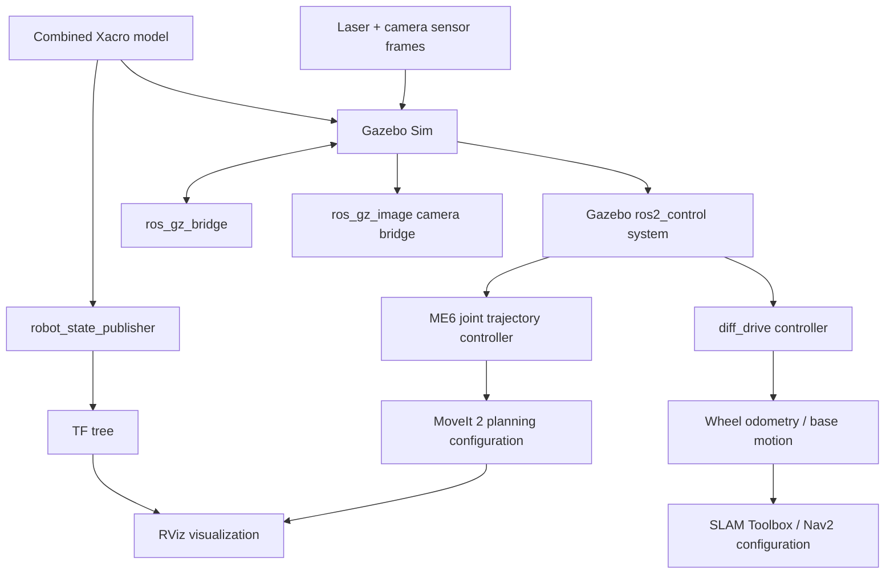

# System Architecture

## 1. Robot composition

The combined robot is described by `autobot_me6_description/urdf/autobot_me6.urdf.xacro` and its simulation variant `autobot_me6_description/urdf/autobot_me6_sim.urdf.xacro`.

The combined Xacro imports the Edubot base material, robot-core, laser and camera macros. It defines a mounting link fixed to the `chassis` and instantiates the ME6 arm macro on that mount. The ME6 macro defines the six revolute arm joints and references the DOBOT ME6 mesh assets from the external `cra_description` package.

## 2. Logical layers

### A. Mobile-base description — `autobot_description`

- Chassis, differential-drive wheels and caster links.
- Base geometry meshes and battery/sensor representation.
- Laser and camera frames/sensor definitions.
- Gazebo world and RViz configuration assets.
- Warehouse world assets referenced by `hall1demo.world`.

### B. Combined arm integration — `autobot_me6_description`

- Combined mobile-base + ME6 Xacro model.
- ME6 arm macro and base mounting transform.
- Gazebo simulation `ros2_control` interface for the wheel and six arm joints.
- Joint/controller configuration used by the Gazebo simulation.

### C. Arm motion planning — `autobot_me6_moveit`

- ME6 planning group semantic description.
- Kinematics and joint limit configuration.
- OMPL/MoveIt launch configuration.
- `FollowJointTrajectory` controller mapping for the six arm joints.
- The included `me6_robot.ros2_control.xacro` selects `mock_components/GenericSystem` for the MoveIt virtual demo.

### D. Mobile base navigation and controls — `autobot_controller`

- Differential-drive and controller-manager configuration.
- Twist mux and Gazebo bridge parameters.
- Nav2 parameters and SLAM Toolbox mapping/localization parameters.
- The saved `small_warehouse_savee` occupancy map used by `nav2.launch.py`.

### E. Launch orchestration — `autobot_bringup`

- Combined Gazebo simulation launch.
- Robot hardware/control launch entry point.
- SLAM Toolbox online mapping/localization launch files.
- Nav2 navigation/localization launch files.
- Camera launch file.

## 3. Main simulation data flow

## 4. External vendor dependency

The combined ME6 macro uses the `cra_description` package namespace for ME6 STL meshes. The combined MoveIt package also declares a dependency on `dobot_rviz`. These DOBOT vendor packages are imported from the official `Dobot-Arm/DOBOT_6Axis_ROS2_V4` repository through the pinned `.repos` manifest; vendor source code is not duplicated in this repository.

## 5. Simulation versus physical hardware

There are two different control descriptions in the supplied source:

- The combined Gazebo Xacro uses `ign_ros2_control/IgnitionSystem` with wheel velocity interfaces and six ME6 position interfaces.
- The standalone combined MoveIt config uses `mock_components/GenericSystem`; this is explicitly a virtual/fake system and will not drive a physical arm.

The launch files and configuration in this repository should therefore be treated as model/simulation and planning integration. A physical system requires a validated mobile-base hardware interface and a real DOBOT ME6 driver/controller configuration, verified topic/action interfaces, physical E-stop and guarded commissioning.
